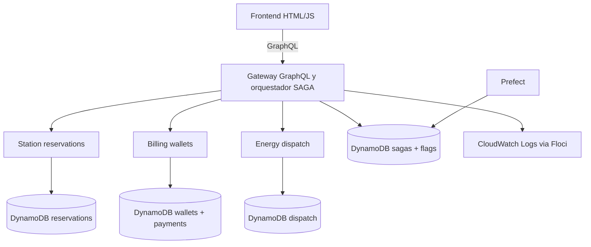
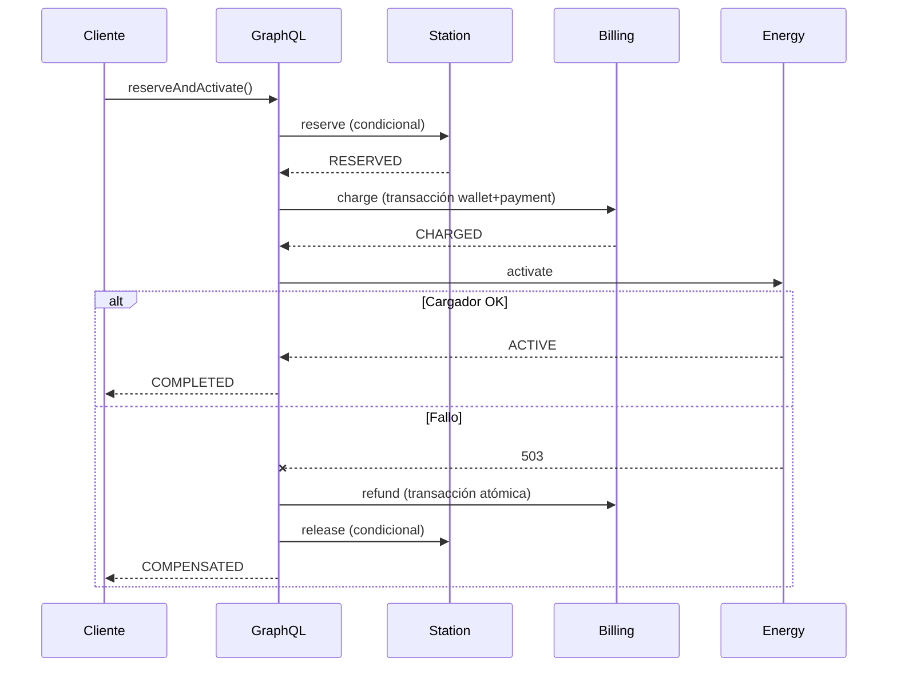

# Análisis arquitectónico y decisiones

## Problema
Evitar reservas concurrentes sobre el mismo conector, cobros retenidos tras averías y despliegues que interrumpan operaciones. En el dominio de movilidad eléctrica la red y la infraestructura de carga pueden fallar de forma independiente.

## Contexto y C4 simplificado

## SAGA

## Patrones y compensaciones
SAGA orquestada; database-per-service; API gateway + BFF GraphQL; feature flags en DynamoDB por workspace; health/readiness; IaC y canary en Kubernetes. Una reserva no se ejecuta dos veces gracias a compare-and-swap `status=AVAILABLE`. El reembolso es idempotente por `payment.pk=saga_id` y actualización condicional.

## Aislamiento
En Compose rápido se crean instancias independientes de Floci en 4566/dev, 4567/test y 4568/prod. En Terraform se prefiere **una instancia Floci persistente para el backend S3** y workspace distintos. Los recursos se nombran por `terraform.workspace`, no por la rama del repositorio implícitamente.

## Seguridad
El demo solo enlaza a `127.0.0.1`; no tiene autenticación ni autorización y NO debe publicarse en Internet. Mutación de flags no tiene control RBAC. AWS credentials `test` son exclusivamente para Floci. No usar en producción.

## Limitaciones del prototipo
La aplicación no integra cargadores OCPP reales, ni WebSocket de telemetría, ni cierre de sesión/facturación final, ni hardware locks distribuidos, ni recuperación de crash basada en cola/outbox. El polling UI es cada 5 segundos, no push verdadero. El despliegue Kubernetes requiere Floci accesible dentro del namespace. El módulo AWS de red crea endpoints pero no EKS/APIGW/VPC Link. CI/CD y protección de ramas solo se completan al configurar GitHub y runner real.
